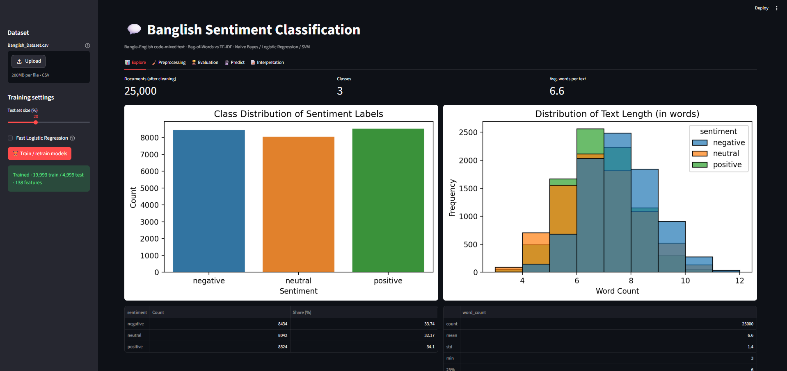
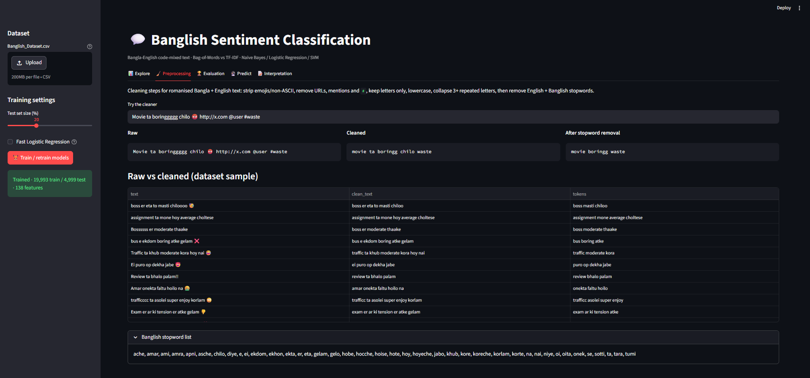
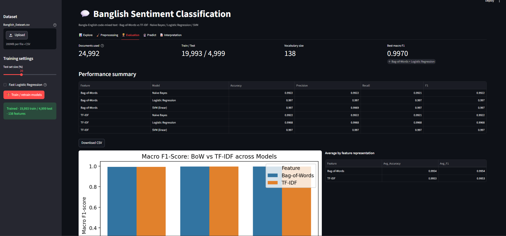
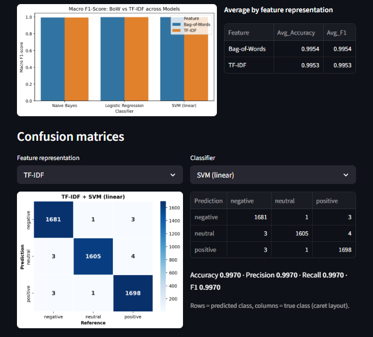
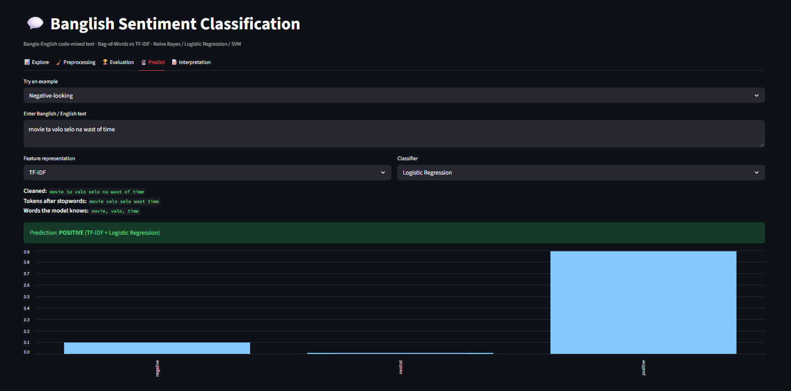

# 🇧🇩🇬🇧 Bangla-English Code-Mixed Sentiment Classification

An NLP and Machine Learning project for **sentiment classification of Bangla-English code-mixed (Banglish) text**.

This project compares two traditional text representation techniques — **Bag-of-Words (BoW)** and **TF-IDF** — using three machine learning classifiers:

- Naive Bayes
- Logistic Regression
- Support Vector Machine (SVM)

The project also includes an interactive **Streamlit web application** for dataset exploration, text preprocessing, model evaluation, model comparison, and real-time sentiment prediction.

---

## 🚀 Live Demo

### Streamlit Application

👉 https://bangla-english-code-mixed-sentiment-classification.streamlit.app/

### GitHub Repository

👉 https://github.com/tanvir-50198/Bangla-English-Code-Mixed-Sentiment-Classification

---

## 🎯 Project Objective

The main objective of this project is to investigate how different traditional text representations affect sentiment classification performance on **Bangla-English code-mixed text**.

The project compares:

```text
Bag-of-Words (BoW)
        vs
TF-IDF
```

with:

```text
Naive Bayes
Logistic Regression
SVM
```

A total of **six model configurations** are evaluated.

The models are compared using:

- Accuracy
- Macro Precision
- Macro Recall
- Macro F1-score
- Confusion Matrix

The best-performing configuration is identified primarily based on **Macro F1-score**.

---

# ✨ Key Features

## 📊 Dataset Exploration

The Streamlit application provides:

- Dataset statistics
- Number of sentiment classes
- Sentiment class distribution
- Word-count statistics
- Word cloud
- Sample dataset preview

## 🧹 Text Preprocessing

The preprocessing pipeline is designed for noisy Bangla-English code-mixed text.

It includes:

- Unicode normalization
- Lowercasing
- URL removal
- Mention removal
- Hashtag handling
- Non-letter character removal
- Repeated-character normalization
- English stopword removal
- Banglish-specific stopword removal
- Duplicate removal
- Empty-text filtering

## 🔢 Feature Representation

Two traditional text representations are implemented:

### Bag-of-Words

Represents text using term-frequency counts.

### TF-IDF

Assigns weights to terms based on their importance within individual documents and their occurrence across the dataset.

## 🤖 Machine Learning Models

Three classifiers are evaluated:

1. Naive Bayes
2. Logistic Regression
3. Support Vector Machine (SVM)

This results in:

```text
2 Feature Representations × 3 Classifiers = 6 Models
```

## 🏆 Model Evaluation

The application provides:

- Accuracy
- Precision
- Recall
- Macro F1-score
- Model comparison
- BoW vs TF-IDF comparison
- Confusion matrices
- Downloadable performance results

## 🔮 Sentiment Prediction

Users can enter Bangla-English or English text and select:

- Feature representation
- Classifier

The application displays:

- Cleaned text
- Tokens
- Model-known vocabulary
- Predicted sentiment
- Prediction confidence where supported
- Predictions from all six model configurations

---

# 🖥️ Application Screenshots

The project includes an interactive Streamlit interface for exploring the dataset, preprocessing text, evaluating models, and performing sentiment prediction.

## 📊 Explore

The Explore section provides dataset statistics, sentiment distribution, word-count analysis, word cloud, and sample records.



---

## 🧹 Text Preprocessing

The preprocessing section demonstrates how raw Bangla-English code-mixed text is cleaned before classification.



---

## 🏆 Model Evaluation

The Evaluation section displays the performance of all six model configurations using Accuracy, Precision, Recall, and Macro F1-score.



---

## 📉 Confusion Matrix

Confusion matrices are used to analyze the classification performance across sentiment classes.



---

## 🔮 Sentiment Prediction

Users can enter Bangla-English or English text and select a feature representation and classifier to generate a sentiment prediction.



### Example

```text
Input:
Ajke valo lage na, onek jam rastay.

Prediction:
Negative
```

---

# 🔬 Project Workflow

```text
                    Dataset
                       │
                       ▼
              Data Preparation
                       │
                       ▼
              Text Preprocessing
                       │
                       ▼
             ┌─────────┴─────────┐
             │                   │
            BoW                TF-IDF
             │                   │
        ┌────┼────┐         ┌────┼────┐
        ▼    ▼    ▼         ▼    ▼    ▼
       NB    LR   SVM       NB    LR   SVM
        │    │    │         │    │    │
        └────┴────┘         └────┴────┘
             │                   │
             └─────────┬─────────┘
                       ▼
                Model Evaluation
                       │
                       ▼
             BoW vs TF-IDF Analysis
                       │
                       ▼
                Best Model Selection
                       │
                       ▼
                Sentiment Prediction
```

---

# 🧹 Text Preprocessing

The preprocessing pipeline is designed specifically for Bangla-English code-mixed and romanized Bangla text.

### Processing Pipeline

```text
Raw Text
   ↓
Unicode Normalization
   ↓
Lowercasing
   ↓
URL Removal
   ↓
Mention Removal
   ↓
Hashtag Handling
   ↓
Non-letter Character Removal
   ↓
Repeated Character Normalization
   ↓
Stopword Removal
   ↓
Clean Text
```

### Example

**Original Text:**

```text
Movie ta boringgggg chilo 😡 http://x.com @user #waste
```

**Cleaned Text:**

```text
movie ta boring chilo waste
```

**After Stopword Removal:**

```text
movie boring waste
```

---

# 🔢 Feature Engineering

## 1. Bag-of-Words

Bag-of-Words represents each document using the frequency of its words.

```text
Text
 ↓
Tokenization
 ↓
Vocabulary
 ↓
Term Frequency Matrix
```

## 2. TF-IDF

TF-IDF assigns greater importance to informative terms and lower importance to terms that appear frequently across documents.

```text
Text
 ↓
Tokenization
 ↓
Term Frequency
 ↓
Inverse Document Frequency
 ↓
TF-IDF Matrix
```

Both feature representations are used to train and compare the three machine learning classifiers.

---

# 🤖 Machine Learning Models

## Naive Bayes

A probabilistic classifier used for text classification.

## Logistic Regression

A regularized Logistic Regression classifier used to learn the relationship between text features and sentiment classes.

## Support Vector Machine

A linear SVM classifier used for sentiment classification.

The three classifiers are trained using both BoW and TF-IDF representations.

---

# 📈 Evaluation Metrics

The project evaluates the models using the following metrics.

### Accuracy

Measures the overall proportion of correctly classified samples.

### Macro Precision

Calculates precision independently for each class and then averages the class-level results.

### Macro Recall

Calculates recall independently for each class and then averages the class-level results.

### Macro F1-score

Calculates the F1-score for each class and takes the average.

Macro F1-score is used as the primary metric for comparing model performance.

### Confusion Matrix

A confusion matrix shows the relationship between actual and predicted sentiment classes.

---

# 📊 Model Performance

The following results were obtained from the six evaluated model configurations.

| Feature Representation | Model | Accuracy | Precision | Recall | Macro F1 |
|---|---|---:|---:|---:|---:|
| BoW | Naive Bayes | 0.9922 | 0.9922 | 0.9921 | 0.9922 |
| BoW | Logistic Regression | **0.9970** | **0.9970** | **0.9970** | **0.9970** |
| BoW | SVM | **0.9970** | 0.9969 | **0.9970** | **0.9970** |
| TF-IDF | Naive Bayes | 0.9922 | 0.9922 | 0.9921 | 0.9922 |
| TF-IDF | Logistic Regression | 0.9968 | 0.9968 | 0.9968 | 0.9968 |
| TF-IDF | SVM | **0.9970** | **0.9970** | **0.9970** | **0.9970** |

---

# 🏆 Best Performing Configurations

The highest observed **Macro F1-score is 0.9970**.

### 🥇 BoW + Logistic Regression

```text
Accuracy  : 0.9970
Precision : 0.9970
Recall    : 0.9970
Macro F1  : 0.9970
```

### 🥇 BoW + SVM

```text
Accuracy  : 0.9970
Precision : 0.9969
Recall    : 0.9970
Macro F1  : 0.9970
```

### 🥇 TF-IDF + SVM

```text
Accuracy  : 0.9970
Precision : 0.9970
Recall    : 0.9970
Macro F1  : 0.9970
```

These three configurations achieved the highest observed Macro F1-score.

---

# 🔎 BoW vs TF-IDF

The results show that both feature representations performed very well on the evaluated dataset.

### BoW

| Model | Macro F1 |
|---|---:|
| Naive Bayes | 0.9922 |
| Logistic Regression | **0.9970** |
| SVM | **0.9970** |

### TF-IDF

| Model | Macro F1 |
|---|---:|
| Naive Bayes | 0.9922 |
| Logistic Regression | 0.9968 |
| SVM | **0.9970** |

The difference between BoW and TF-IDF is small for this dataset.

BoW achieved a slightly higher result than TF-IDF with Logistic Regression, while SVM achieved the same Macro F1-score using both representations.

---

# 🖥️ Streamlit Application

The application contains five main sections.

## 📊 Explore

Provides:

- Dataset statistics
- Sentiment distribution
- Word-count distribution
- Word cloud
- Dataset samples

## 🧹 Preprocessing

Allows users to enter custom text and inspect the preprocessing pipeline.

```text
Raw Text
   ↓
Cleaned Text
   ↓
After Stopword Removal
```

## 🏆 Evaluation

Provides:

- Six-model performance table
- Accuracy
- Precision
- Recall
- Macro F1
- Feature representation comparison
- Model comparison chart
- Confusion matrix
- Downloadable CSV results

## 🔮 Predict

Users can enter custom Bangla-English or English text.

### Example

```text
Input:
Ajke valo lage na, onek jam rastay.
```

```text
Prediction:
Negative
```

The prediction interface also provides information about the cleaned input, recognized vocabulary, and predictions from different model configurations.

## 📝 Interpretation

The application provides an interpretation of the evaluation results and identifies the better-performing feature representation and model configuration.

---

# 📁 Project Structure

```text
Bangla-English-Code-Mixed-Sentiment-Classification/
│
├── app.py
├── Banglish_Sentiment.ipynb
├── Banglish_Dataset.csv
├── requirements.txt
├── README.md
├── .gitignore
│
└── screenshots/
    ├── explore.png
    ├── preprocessing.png
    ├── evaluation.png
    ├── confusion-matrix.png
    └── prediction.png
```

---

# 🛠️ Technologies Used

### Programming Language

- Python

### Machine Learning & NLP

- Scikit-learn
- NumPy
- Pandas
- SciPy

### Data Visualization

- Matplotlib
- Seaborn
- WordCloud

### Web Application

- Streamlit

### Development Tools

- Jupyter Notebook
- VS Code
- Git
- GitHub

---

# 📦 Installation

## 1. Clone the Repository

```bash
git clone https://github.com/tanvir-50198/Bangla-English-Code-Mixed-Sentiment-Classification.git
```

## 2. Navigate to the Project

```bash
cd Bangla-English-Code-Mixed-Sentiment-Classification
```

## 3. Create a Virtual Environment

```bash
python -m venv .venv
```

## 4. Activate the Virtual Environment

### Windows

```bash
.venv\Scripts\activate
```

## 5. Install Dependencies

```bash
pip install -r requirements.txt
```

---

# ▶️ Run Locally

Start the Streamlit application:

```bash
streamlit run app.py
```

The application will open in your browser.

If it does not open automatically, use the local URL displayed in the terminal.

---

# 📄 Dataset Format

The application expects a CSV dataset containing two required columns:

```text
text
sentiment
```

### Example

| text | sentiment |
|---|---|
| movie ta darun hoyeche | positive |
| ekdom baje movie | negative |
| movie ta average chilo | neutral |
| Ajke valo lage na, onek jam rastay | negative |

The dataset can be loaded by the application and used for training and evaluation.

---

# ⚙️ Training Configuration

The Streamlit application provides configurable training options.

Users can configure:

- Test set size
- Logistic Regression training mode
- Model retraining

A fixed random seed is used for reproducibility.

```text
Random Seed = 42
```

---

# 📥 Model Performance Download

The application provides an option to download the model performance summary as a CSV file.

The summary contains:

```text
Feature
Model
Accuracy
Precision
Recall
F1
```

This allows the evaluation results to be saved for further analysis.

---

# 💡 Key Learning Outcomes

This project demonstrates practical experience with:

- Natural Language Processing
- Bangla-English code-mixed text
- Sentiment classification
- Text preprocessing
- Feature engineering
- Bag-of-Words
- TF-IDF
- Naive Bayes
- Logistic Regression
- Support Vector Machine
- Train-test splitting
- Model comparison
- Accuracy evaluation
- Macro Precision
- Macro Recall
- Macro F1-score
- Confusion Matrix
- Data visualization
- Streamlit application development
- Interactive machine learning deployment

---

# ⚠️ Limitations

Although the models achieved very high performance on the evaluated dataset, the reported results depend on the selected dataset and evaluation setup.

Therefore, these results should not automatically be interpreted as generalization performance on all real-world Bangla-English social-media text.

Potential challenges include:

- Spelling variations
- Transliteration differences
- Informal language
- Code-switching
- Repeated characters
- Emojis
- Unseen vocabulary
- Ambiguous sentiment

---

# 🚀 Future Improvements

Possible future improvements include:

- Character-level n-gram features
- Subword features
- FastText embeddings
- Word embeddings
- Larger and more diverse datasets
- Multilingual transformer models
- mBERT
- XLM-R
- Fine-tuning transformer models for Bangla-English code-mixed text
- Improved handling of emojis and informal expressions

---

# 👨‍💻 Author

## Abdur Rahman Tanvir

**Computer Science & Engineering**  
American International University-Bangladesh (AIUB)

### GitHub

https://github.com/tanvir-50198

### LinkedIn

https://linkedin.com/in/tanvir-rahman-50198/

---

# 🔗 Project Links

### 🌐 Live Demo

https://bangla-english-code-mixed-sentiment-classification.streamlit.app/

### 💻 GitHub Repository

https://github.com/tanvir-50198/Bangla-English-Code-Mixed-Sentiment-Classification

---

## ⭐ If you find this project useful, consider giving the repository a star!